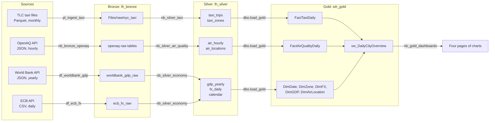
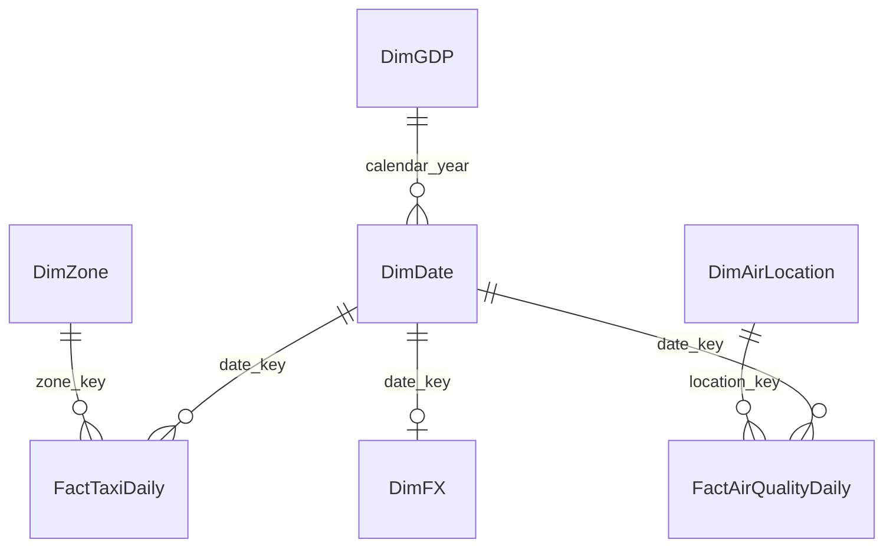

# NYC Mobility, Air Quality and Economy on Microsoft Fabric

A small analytics platform that brings three public data sets together in one place:

- **Mobility:** NYC yellow taxi trips (TLC)
- **Environment:** hourly PM2.5 and NO2 measurements (OpenAQ)
- **Economy:** US GDP per year (World Bank) and the daily USD/EUR rate (ECB)

The data flows through a medallion architecture (**Bronze → Silver → Gold**) and ends in a star schema and four pages of charts. One pipeline runs the whole flow.

**Period covered:** 1 June 2026 to 31 August 2026 (taxi and air quality). Exchange rates start on 2 January 2026. GDP covers 1960 to 2025.

---

## 1. Status

| Requirement from the task | Status | Where |
|---|---|---|
| Phase 1: ingest all sources into Bronze | Done | `pl_ingest_taxi`, `df_worldbank_gdp`, `df_ecb_fx`, `nb_bronze_openaq` |
| Phase 2: clean and standardize into Silver (PySpark) | Done | `nb_silver_taxi`, `nb_silver_air_quality`, `nb_silver_economy` |
| Phase 3: star schema in a Fabric Warehouse | Done | `wh_gold`, procedure `dbo.load_gold` |
| Phase 4: visualizations (four dashboards) | Done as notebook charts | `nb_gold_dashboards` |
| Phase 5: automated refresh | Done | `pl_daily_refreshing` |
| Phase 5: Purview lineage, row-level security | Not done (optional in the task) | see section 10 |
| All code under source control | Done | folder `fabric/` in this repository |
| Extendability | Described | section 8 |
| Extra integrations (weather + Grafana, Great Expectations + bot) | Not done | section 10 |

---

## 2. Architecture



What each layer means in this project:

| Layer | Rule | Example |
|---|---|---|
| **Bronze** | A copy of the source, not changed. Files stay files; API answers are also saved as raw JSON. | Taxi Parquet files as they were downloaded |
| **Silver** | Clean, typed, one meaning per column. Bad rows are marked and counted, then removed. | `taxi_trips` with only valid trips |
| **Gold** | Aggregated and shaped for reporting: facts (numbers) and dimensions (descriptions). | `FactTaxiDaily`: one row per day and zone |

---

## 3. Fabric items

| Item | Type | What it does |
|---|---|---|
| `lh_bronze` | Lakehouse | Raw data (files and `*_raw` tables) |
| `lh_silver` | Lakehouse | Clean tables |
| `wh_gold` | Warehouse | Star schema, the load procedure and the view |
| `pl_ingest_taxi` | Pipeline | Downloads the monthly taxi files and the zone lookup |
| `df_worldbank_gdp` | Dataflow Gen2 | Loads GDP per year |
| `df_ecb_fx` | Dataflow Gen2 | Loads the daily USD/EUR rate |
| `nb_bronze_openaq` | Notebook | Downloads air quality data from the OpenAQ API |
| `nb_silver_taxi` | Notebook | Bronze → Silver for taxi |
| `nb_silver_air_quality` | Notebook | Bronze → Silver for air quality |
| `nb_silver_economy` | Notebook | Bronze → Silver for GDP and FX, and builds the calendar |
| `nb_gold_dashboards` | Notebook | Reads Gold and draws the four chart pages |
| `pl_daily_refreshing` | Pipeline | Runs everything in the right order |

Naming rules: `lh_` lakehouse, `wh_` warehouse, `pl_` pipeline, `df_` dataflow, `nb_` notebook. Bronze tables end with `_raw`. Gold tables start with `Fact` or `Dim`.

---

## 4. Bronze: ingestion

| Source | Tool | Why this tool | Lands in |
|---|---|---|---|
| TLC taxi trips | Pipeline with a Copy activity inside a ForEach loop | Files are copied as they are; no transformation is needed | `Files/raw/nyc_taxi/year=YYYY/month=MM/` |
| World Bank GDP | Dataflow Gen2 | One URL, no secret, small result | table `worldbank_gdp_raw` |
| ECB FX rate | Dataflow Gen2 | One URL, no secret, small result | table `ecb_fx_raw` |
| OpenAQ air quality | Notebook | See below | raw JSON in `Files/raw/openaq/` and tables `openaq_*_raw` |

**Why OpenAQ uses a notebook and not a Dataflow.** The task suggests Dataflow Gen2 for APIs. For OpenAQ this was not a good fit, for four reasons: the API needs a secret key in a request header, the answers come in pages (at most 1,000 rows per page), each of the 51 sensors needs its own requests, and the free plan allows only 60 requests per minute. A notebook handles all four in a few lines and keeps the key out of the code.

Details that matter:

- **Taxi months are a parameter.** `pl_ingest_taxi` has a parameter `months` (for example `["2026-06","2026-07","2026-08"]`). The ForEach loop builds the file name and the target folder from each value.
- **Folders use the pattern `year=YYYY/month=MM`.** Running the pipeline again overwrites the same file, so there are no duplicates.
- **Air quality area.** Stations are selected with a bounding box around New York City. Only PM2.5 and NO2 sensors that were active in the period are downloaded.
- **Bronze row counts:** 3 taxi files (10,704,073 trips), 83,376 hourly air quality rows from 51 sensors, 66 GDP rows, one FX row per business day.

---

## 5. Silver: cleaning and standardizing

Every Silver notebook has the same five steps: **Settings → Helper functions → Standardize and check quality → Clean and save → Check the result**.

Bad rows are never deleted silently. Each row first gets a mark (`ok` or the reason it is bad). The marks are counted and saved in a report table. Only then the bad rows are removed.

### 5.1 Taxi (`nb_silver_taxi`)

| Rule | A row is bad when |
|---|---|
| `missing_time` | pickup or dropoff time is empty |
| `pickup_outside_month` | the pickup is not in the month of the file |
| `bad_duration` | the trip takes 0 minutes or less, or more than 360 minutes |
| `bad_distance` | the distance is 0 or less, or more than 100 miles |
| `bad_amount` | the total amount is 0 or less |

Result (saved in `taxi_quality_report`):

| Month | Raw rows | Clean rows | Clean share | bad_distance | bad_duration | bad_amount | outside month |
|---|---:|---:|---:|---:|---:|---:|---:|
| 2026-06 | 3,837,248 | 3,646,477 | 95.0% | 126,704 | 51,135 | 12,915 | 17 |
| 2026-07 | 3,530,109 | 3,346,361 | 94.8% | 126,845 | 43,500 | 13,357 | 46 |
| 2026-08 | 3,336,716 | 3,163,711 | 94.8% | 115,825 | 44,139 | 13,026 | 15 |
| **Total** | **10,704,073** | **10,156,549** | **94.9%** | | | | |

No exact duplicate rows were found. All pickup zone ids exist in the zone table (265 zones).

### 5.2 Air quality (`nb_silver_air_quality`)

- **Units are normalized.** NO2 arrives in ppm and is converted to ppb (× 1,000). PM2.5 stays in µg/m³.
- **Times are converted to New York local time,** so that air quality and taxi data use the same calendar day.

| Rule | A row is bad when |
|---|---|
| `missing_time`, `missing_value` | the time or the value is empty |
| `negative_value` | the value is below 0 |
| `value_too_high` | PM2.5 above 1,000 µg/m³ or NO2 above 1,000 ppb |
| `low_coverage` | the hour has less than 50% of its expected readings |
| `sparse_sensor` | the sensor has good data for less than half of the 2,208 hours in the period |

Result (saved in `air_quality_report`):

| Pollutant | Raw rows | Clean rows | Sensors kept | Removed |
|---|---:|---:|---:|---|
| PM2.5 | 74,835 | 69,256 (92.5%) | 34 | 4,295 sparse sensor (9 sensors), 660 negative, 624 low coverage |
| NO2 | 8,541 | 8,541 (100%) | 4 | none |

36 of the 75 stations in the area have usable data.

### 5.3 Economy and calendar (`nb_silver_economy`)

- **Calendar:** one row per day of 2026 with year, month, day name and a weekend flag. It is generated in the notebook, not ingested.
- **FX rate:** the ECB publishes no rate on weekends and holidays. Those days get the last known rate and are marked with `is_filled = true`. Every calendar day between the first and the last published rate has a rate.
- **GDP:** one row per year; years without a value are dropped.

---

## 6. Gold: star schema

The stored procedure `dbo.load_gold` reads the Silver tables (`lh_silver.dbo.<table>`) and rebuilds all Gold tables. Running it again gives the same result.



| Table | One row is | Rows |
|---|---|---:|
| `FactTaxiDaily` | one day and one pickup zone | 21,836 |
| `FactAirQualityDaily` | one day, one station and one pollutant | 3,227 |
| `DimDate` | one day | 365 |
| `DimZone` | one taxi zone | 265 |
| `DimFX` | one day with its exchange rate | 323 (grows every day) |
| `DimGDP` | one year | 66 |
| `DimAirLocation` | one air quality station | 36 |

Design decisions:

- **The taxi fact stores totals, not averages.** Averages cannot be added up. A report calculates them from the totals, for example average fare = `fare_usd / trip_count`.
- **Revenue in euros uses the rate of the same day.**
- **An air quality day counts only if at least 18 of its 24 hours were measured.**
- **`DimAirLocation` is an addition** to the dimension list in the task. The air quality dashboard needs station names and coordinates.
- **`vw_DailyCityOverview`** puts the daily taxi totals, the city averages of PM2.5 and NO2, and the exchange rate in one row per day. It answers the first analytical question of the task directly.

Check: the sum of `trip_count` in `FactTaxiDaily` is 10,156,549, the same as the number of clean trips in Silver.

---

## 7. Orchestration

`pl_daily_refreshing` runs eight activities in one chain. Each activity starts only if the one before it succeeded.

| # | Activity | Runs | Time in the test run |
|---|---|---|---:|
| 1 | `run_ingest_taxi` | pipeline `pl_ingest_taxi` | 1 min 8 s |
| 2 | `run_df_worldbank_gdp` | dataflow | 41 s |
| 3 | `run_df_ecb_fx` | dataflow | 33 s |
| 4 | `run_bronze_openaq` | notebook | 6 min 41 s |
| 5 | `run_silver_taxi` | notebook | 1 min 7 s |
| 6 | `run_air_quality` | notebook | 1 min 37 s |
| 7 | `run_silver_economy` | notebook | 50 s |
| 8 | `run_gold_load` | stored procedure `dbo.load_gold` | 10 s |

**Schedule:** the pipeline is set to run once a day (Run → Schedule).

The full run takes about 13 minutes. The OpenAQ step is the slowest because the notebook waits about one second before every request to respect the API limit.

**Why one chain and not parallel branches:** the capacity (F2) is small, and the order Bronze → Silver → Gold must be kept. If one step fails, the steps after it do not run on incomplete data.

**Every step can be run again safely.** Files are overwritten at the same path, tables are replaced, and the Gold procedure drops and rebuilds its tables.

---

## 8. Extendability: how to add a new source

Example: adding weather data.

1. **Bronze.** Choose the tool with this rule: one URL without a secret → Dataflow Gen2; files → pipeline with Copy; an API with a key, pages or many calls → notebook. Land the data in `lh_bronze` as `Files/raw/weather/...` or as a table `weather_<content>_raw`.
2. **Silver.** Copy one of the Silver notebooks as `nb_silver_weather`. Keep the five steps. Change the columns, the units and the quality rules. Save the result with `save_silver_table(...)`.
3. **Gold.** Add one step to `dbo.load_gold`, for example `FactWeatherDaily` with a `date_key`. Because every fact uses the same `date_key`, the new table joins to `DimDate` and to the other facts without extra work.
4. **Pipeline.** Add the new activities to `pl_daily_refreshing`: the ingestion after the other Bronze steps, the Silver notebook before `run_gold_load`.
5. **Documentation.** Add the tables to section 11 of this file.

What makes this easy:

- **One notebook per source.** Sources do not depend on each other; one can fail or change without touching the others.
- **The same structure everywhere.** Every Silver notebook has the same five steps and the same two helper functions.
- **No hard-coded IDs.** Notebooks find the Silver lakehouse by its name, so the code also works in another workspace.
- **New taxi months need no code change.** Add the month to the `months` parameter; `nb_silver_taxi` processes every month it finds in Bronze.
- **One shared date key** (`date_key`, for example 20260601) connects all facts.

---

## 9. Results

The charts are created by `nb_gold_dashboards` from the Gold layer.

### 9.1 Mobility


- Between about 78,000 and 159,000 trips per day, with a clear weekly pattern. The lowest days are around the 4 July holiday and at the end of August.
- The average fare is about 21 US dollars per trip.
- Busiest pickup zones: JFK Airport (434,500 trips), Midtown Center (432,200), Upper East Side South (427,700), Upper East Side North (362,500), Penn Station/Madison Sq West (328,700).

### 9.2 Air quality


- PM2.5 is below 20 µg/m³ on most days.
- There is one strong episode in the middle of July: for about four days the city average is between 49 and 87 µg/m³.
- NO2 moves between about 4 and 28 ppb.

### 9.3 Mobility and air quality


- The correlation between trips per day and PM2.5 is **0.15**. This is weak: in these 92 days, days with more taxi trips are not clearly days with worse air.
- During the PM2.5 episode in July the number of trips stayed at its normal level (114,000 to 128,000 per day).
- The charts do not use two different scales on one chart. Two scales can be lined up in any way and can show a relation that is not in the data. The two measures are shown below each other with the same dates.

### 9.4 Economic impact


- Taxi revenue is a few million US dollars per day; the lowest day is about 2.3 million.
- The rate moved between 1.134 and 1.170 US dollars for one euro in the period. The same revenue is worth about 3% more or less in euros depending on the day.
- US GDP in 2025: 30.8 trillion US dollars.

### 9.5 The analytical questions of the task

| Question | Answer from this data |
|---|---|
| How do taxi trips per day relate to PM2.5 and NO2? | Weak relation (correlation with PM2.5: 0.15). See 9.3. |
| Which zones and times are busiest? | Airports and Midtown / Upper East Side. See 9.1. Busiest hours are not charted yet; `taxi_trips` has the column `pickup_hour` for it. |
| How does revenue look in USD and in EUR? | See 9.4. The gap between the two lines is the exchange rate of the day. |
| Long-term growth and environment | GDP per year is in `DimGDP` with the growth to the year before. With three months of taxi and air data, a long-term comparison is not possible yet. |

---

## 10. Governance, limits and next steps

### Governance

| Topic | How it is handled |
|---|---|
| **Secrets** | The OpenAQ API key is stored in a file in the Lakehouse (`Files/config/openaq_key.txt`). It is never written in code and is not in this repository. |
| **Source control** | The workspace is connected to this repository (folder `fabric/`). Pipelines, dataflows, notebooks and the warehouse definition are committed from Fabric. |
| **Data quality** | Every Silver notebook writes a quality report table and ends with checks. Gold is checked against Silver (trip totals must match). |
| **Lineage** | The diagram in section 2 shows which item writes which table. The Fabric lineage view shows the same on item level. |
| **Personal data** | The data sets contain no personal data. Taxi trips have no passenger or driver identity; locations are zones, not addresses. |
| **Access** | One workspace, one administrator. Recommended for more users: report readers get read access to `wh_gold` only; Bronze and Silver stay with the engineers. |
| **Cost** | The capacity is paused when it is not needed. The scheduled run needs an active capacity. |

### Known limits

- **Fixed period.** The taxi months and the OpenAQ dates are settings, not automatic "last three months". A new period needs a change of the `months` parameter and of two dates in `nb_bronze_openaq`.
- **The air quality area is a rectangle.** It also covers a part of New Jersey, so a few stations are outside New York City (for example Fort Lee, which is among the stations with the highest PM2.5).
- **Air quality is on city level only.** Stations are not yet matched to taxi zones, so "zone with much traffic and bad air" cannot be shown.
- **NO2 comes from only four sensors.**
- **Negative PM2.5 values are removed.** Some reference monitors report small negative values at very clean air; removing them makes the average slightly higher.
- **Charts are static** (notebook output). There is no interactive Power BI report yet.

### Next steps

1. Match stations to taxi zones with the TLC zone shapes. This fixes the New Jersey problem and allows analysis per zone.
2. Make the period a parameter of `pl_daily_refreshing` and pass it to the taxi pipeline and the OpenAQ notebook.
3. Build a Power BI report on `wh_gold`.
4. Add a chart of trips per hour.
5. Optional integrations from the task: weather data with a time-series database and Grafana; Great Expectations checks with a chat bot trigger.

---

## 11. Data dictionary

### Bronze (`lh_bronze`)

| Object | Content |
|---|---|
| `Files/raw/nyc_taxi/year=YYYY/month=MM/yellow_tripdata_YYYY-MM.parquet` | Taxi trips of one month, as published by TLC |
| `Files/raw/nyc_taxi/lookup/taxi_zone_lookup.csv` | Taxi zones (id, borough, zone, service zone) |
| `Files/raw/openaq/locations.json`, `Files/raw/openaq/hours/sensor_<id>.json` | Raw API answers |
| `openaq_locations_raw` | 75 stations in the area |
| `openaq_sensors_raw` | 51 PM2.5 and NO2 sensors that were downloaded |
| `openaq_hours_raw` | 83,376 hourly values |
| `worldbank_gdp_raw` | GDP per year as returned by the API |
| `ecb_fx_raw` | Daily reference rate as returned by the API |

### Silver (`lh_silver`)

**`taxi_trips`**: one row per valid trip (10,156,549 rows)

| Column | Type | Meaning |
|---|---|---|
| `source_month` | text | Month of the source file, for example `2026-06` |
| `vendor_id` | int | Taxi technology provider code |
| `pickup_datetime`, `dropoff_datetime` | timestamp | Start and end of the trip, New York local time |
| `pickup_location_id`, `dropoff_location_id` | int | Taxi zone ids |
| `passenger_count` | int | Number of passengers (can be empty) |
| `trip_distance_miles` | number | Distance in miles |
| `payment_type` | int | Payment code |
| `fare_amount`, `tip_amount`, `total_amount` | number | Amounts in US dollars |
| `trip_minutes` | number | Trip length in minutes |
| `pickup_date` | date | Day of the pickup |
| `pickup_hour` | int | Hour of the pickup (0 to 23) |

**`taxi_zones`**: `location_id`, `borough`, `zone`, `service_zone` (265 rows)

**`taxi_quality_report`**: `source_month`, `quality_check`, `row_count`

**`air_hourly`**: one row per sensor and hour (77,797 rows)

| Column | Type | Meaning |
|---|---|---|
| `sensor_id`, `location_id` | whole number | Sensor and its station |
| `parameter` | text | `pm25` or `no2` |
| `unit` | text | `µg/m³` for PM2.5, `ppb` for NO2 |
| `value` | number | Hourly value in that unit |
| `measured_at_utc` | timestamp | Start of the hour in UTC |
| `measurement_date`, `measurement_hour` | date, int | Day and hour in New York local time |
| `percent_coverage` | number | Share of expected readings received in that hour |

**`air_locations`**: `location_id`, `location_name`, `provider`, `is_monitor`, `latitude`, `longitude` (36 rows)

**`air_quality_report`**: `parameter`, `quality_check`, `row_count`, `sensors`

**`calendar`**: `date_key`, `calendar_date`, `year`, `month`, `month_name`, `day`, `day_of_week` (1 = Monday), `day_name`, `is_weekend` (365 rows)

**`fx_daily`**: `rate_date`, `usd_per_eur`, `eur_per_usd`, `is_filled` (true = weekend or holiday, last known rate used)

**`gdp_yearly`**: `country_code`, `year`, `gdp_usd` (66 rows)

### Gold (`wh_gold`)

**`FactTaxiDaily`**

| Column | Meaning |
|---|---|
| `date_key` | Day, as a number like 20260601. Joins to `DimDate` |
| `zone_key` | Pickup zone. Joins to `DimZone` |
| `trip_count` | Number of trips |
| `fare_usd`, `tip_usd`, `revenue_usd` | Sums in US dollars (`revenue_usd` is the total amount) |
| `revenue_eur` | Revenue in euros, with the rate of that day |
| `distance_miles`, `trip_minutes` | Sums of distance and time |

**`FactAirQualityDaily`**

| Column | Meaning |
|---|---|
| `date_key` | Day. Joins to `DimDate` |
| `location_key` | Station. Joins to `DimAirLocation` |
| `parameter`, `unit` | Pollutant and its unit |
| `avg_value`, `min_value`, `max_value` | Daily average, lowest and highest hourly value |
| `hours_measured` | Number of hours with data (18 to 24) |

**`DimDate`**: `date_key`, `full_date`, `calendar_year`, `calendar_month`, `month_name`, `day_of_month`, `day_of_week`, `day_name`, `is_weekend`

**`DimZone`**: `zone_key`, `borough`, `zone_name`, `service_zone`

**`DimFX`**: `date_key`, `rate_date`, `usd_per_eur`, `eur_per_usd`, `is_filled`

**`DimGDP`**: `calendar_year`, `country_code`, `gdp_usd`, `gdp_growth_percent`

**`DimAirLocation`**: `location_key`, `location_name`, `provider`, `is_monitor`, `latitude`, `longitude`

**`vw_DailyCityOverview`**: one row per day: `date_key`, `full_date`, `day_name`, `is_weekend`, `trip_count`, `revenue_usd`, `revenue_eur`, `avg_fare_usd`, `avg_trip_minutes`, `avg_pm25`, `avg_no2_ppb`, `pm25_stations`, `no2_stations`, `usd_per_eur`

---

## 12. How to run

1. Connect a Fabric workspace to this repository (Git folder `fabric`) and update the workspace from Git.
2. Get a free OpenAQ API key and save it as a text file in `lh_bronze` at `Files/config/openaq_key.txt`.
3. Run the pipeline `pl_daily_refreshing`. It takes about 13 minutes.
4. Open `nb_gold_dashboards` and run all cells to see the charts.

To load other months, change the `months` parameter of `pl_ingest_taxi` and the two dates in the first cell of `nb_bronze_openaq`.

## 13. Repository layout

```
README.md            this file
docs/images/         the four chart pages
fabric/              all Fabric items, synchronized by the Fabric Git integration
```
