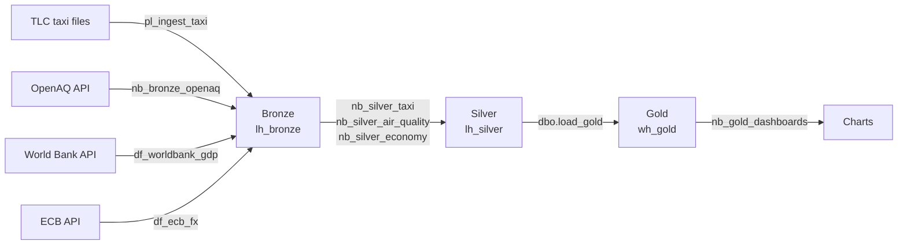

# NYC taxi, air quality and economy data on Microsoft Fabric

This is my course project for the Data Engineer track. I load three public data sets into Microsoft Fabric, clean them, build a small star schema on top and draw some charts from it.

- Taxi: NYC yellow taxi trips (TLC), June to August 2026
- Air quality: hourly PM2.5 and NO2 from OpenAQ, same three months
- Economy: US GDP per year (World Bank) and the daily USD/EUR rate (ECB)

The data goes through three layers: Bronze (raw), Silver (clean), Gold (ready for reports). One pipeline runs everything.

## What is done and what is not

Done:

- Ingestion of all four sources into Bronze
- Cleaning in PySpark notebooks into Silver, with a quality report per source
- Star schema in a Fabric Warehouse (Gold)
- Four pages of charts from the Gold layer
- One pipeline that runs the whole flow
- All Fabric items are in this repository (folder `fabric/`)

Not done:

- Power BI report (the charts are notebook output)
- Purview lineage and row-level security (both optional in the task)
- The two extra integrations (weather with Grafana, Great Expectations with a bot)

## How the data flows

| Item | Type | Job |
|---|---|---|
| `lh_bronze`, `lh_silver` | Lakehouse | Raw data and clean data |
| `wh_gold` | Warehouse | Star schema, load procedure, one view |
| `pl_ingest_taxi` | Pipeline | Downloads the monthly taxi files and the zone list |
| `df_worldbank_gdp`, `df_ecb_fx` | Dataflow Gen2 | Load GDP and the FX rate |
| `nb_bronze_openaq` | Notebook | Downloads air quality data from the API |
| `nb_silver_taxi`, `nb_silver_air_quality`, `nb_silver_economy` | Notebook | Bronze to Silver, one notebook per source |
| `nb_gold_dashboards` | Notebook | Reads Gold and draws the charts |
| `pl_daily_refreshing` | Pipeline | Runs all of the above in order |

## Bronze

Bronze is a copy of the source. I do not change anything here.

- **Taxi.** A pipeline with a Copy activity inside a ForEach loop. The loop runs over a parameter `months`, for example `["2026-06","2026-07","2026-08"]`. Files land in `Files/raw/nyc_taxi/year=YYYY/month=MM/`. If I run it again, the same file is overwritten, so nothing is duplicated.
- **GDP and FX.** Two Dataflows Gen2. Each one calls one URL and writes one table.
- **Air quality.** A notebook. The task suggests Dataflow Gen2 for APIs, but OpenAQ did not fit: it needs a secret key in a header, the answer comes in pages of at most 1,000 rows, every sensor needs its own requests (51 sensors), and the free plan allows 60 requests per minute. In a notebook this is a few lines, and the key stays in a file in the Lakehouse, not in the code.

Stations are selected with a rectangle around New York City. I only download PM2.5 and NO2 sensors that were active in the three months.

What landed: 3 taxi files with 10,704,073 trips, 83,376 hourly air quality values, 66 GDP rows and one FX row per business day.

## Silver

The three Silver notebooks have the same structure: settings, two helper functions, quality check, clean and save, check the result.

I do not delete bad rows silently. Every row first gets a mark, `ok` or the reason. The marks are counted and saved as a small report table. After that the bad rows are removed.

### Taxi

A row is bad if the pickup or dropoff time is missing, the pickup is not in the month of the file, the trip takes 0 minutes or more than 6 hours, the distance is 0 or more than 100 miles, or the total amount is 0 or negative. The limits (6 hours, 100 miles) are my decision.

| Month | Raw rows | Clean rows | Share |
|---|---:|---:|---:|
| 2026-06 | 3,837,248 | 3,646,477 | 95.0% |
| 2026-07 | 3,530,109 | 3,346,361 | 94.8% |
| 2026-08 | 3,336,716 | 3,163,711 | 94.8% |
| Total | 10,704,073 | 10,156,549 | 94.9% |

Most removed rows have a distance of 0 or above 100 miles (about 3.5% of all rows). I found no exact duplicates. Every pickup zone id exists in the zone table.

### Air quality

- NO2 comes in ppm. I convert it to ppb (times 1,000). PM2.5 stays in µg/m³.
- Times are converted to New York local time, so taxi and air quality use the same day.
- A row is bad if the value is missing, negative or above 1,000, or if the hour has less than half of its expected readings.
- A sensor is removed completely if it has good data for less than half of the 2,208 hours. Some sensors had only a few hours.

PM2.5: 69,256 of 74,835 rows kept (92.5%), from 34 sensors. NO2: all 8,541 rows kept, from 4 sensors. In the end 36 of 75 stations have usable data.

### Economy

- The ECB has no rate on weekends and holidays, but taxis also drive on those days. I fill those days with the last known rate and mark them with `is_filled`.
- The notebook also creates a calendar table with one row per day of 2026. It is used for filling the FX gaps and becomes `DimDate` in Gold.
- GDP: one row per year. Years without a value are dropped.

## Gold

The procedure `dbo.load_gold` reads the Silver tables and rebuilds all Gold tables. I can run it as often as I want; the result is the same.

| Table | One row is | Rows |
|---|---|---:|
| `FactTaxiDaily` | one day and one pickup zone | 21,836 |
| `FactAirQualityDaily` | one day, one station, one pollutant | 3,227 |
| `DimDate` | one day | 365 |
| `DimZone` | one taxi zone | 265 |
| `DimFX` | one day with its rate | 323 and growing |
| `DimGDP` | one year | 66 |
| `DimAirLocation` | one station | 36 |

The facts join to `DimDate` with `date_key` (a number like 20260601). `FactTaxiDaily` joins to `DimZone` with `zone_key`, `FactAirQualityDaily` joins to `DimAirLocation` with `location_key`.

Some decisions:

- The taxi fact has totals, not averages. Averages cannot be summed. The average fare is `fare_usd / trip_count`.
- Revenue in euros is calculated with the rate of the same day.
- A station day is kept only if at least 18 of 24 hours were measured.
- `DimAirLocation` is not in the task list. I added it because the charts need station names.
- The view `vw_DailyCityOverview` has one row per day with trips, revenue, PM2.5, NO2 and the rate. Most charts read from it.

To check Gold against Silver I sum `trip_count` in `FactTaxiDaily`. It must be 10,156,549, the number of clean trips.

## Pipeline

`pl_daily_refreshing` has eight activities in one line. An activity starts only if the one before succeeded.

| Step | Runs | Time |
|---|---|---:|
| `run_ingest_taxi` | `pl_ingest_taxi` | 1 min 8 s |
| `run_df_worldbank_gdp` | dataflow | 41 s |
| `run_df_ecb_fx` | dataflow | 33 s |
| `run_bronze_openaq` | notebook | 6 min 41 s |
| `run_silver_taxi` | notebook | 1 min 7 s |
| `run_air_quality` | notebook | 1 min 37 s |
| `run_silver_economy` | notebook | 50 s |
| `run_gold_load` | `dbo.load_gold` | 10 s |

About 13 minutes in total. The OpenAQ step is slow because the notebook waits one second before each request.

I did not use parallel branches. My capacity is small (F2), and I want the order Bronze, Silver, Gold to be fixed. If a step fails, the next ones do not run.

## Charts

Made by `nb_gold_dashboards`.

Between about 78,000 and 159,000 trips per day, with a weekly pattern. The lowest days are around 4 July and at the end of August. The busiest pickup zone is JFK Airport, then Midtown Center and Upper East Side South. The average fare is around 21 dollars.

PM2.5 is below 20 µg/m³ on most days. In the middle of July there are about four days where the city average is between 49 and 87. NO2 is between about 4 and 28 ppb.

The correlation between trips per day and PM2.5 is 0.15, which is weak. On the four bad days in July the number of trips was normal (114,000 to 128,000). So in this data I do not see that more taxi traffic means worse air on the same day. It is only 92 days, and the four extreme days have a big effect on the number.

I did not put trips and PM2.5 on one chart with two y-axes. With two scales you can make any two lines look related. They are below each other with the same dates.

Revenue is a few million dollars per day. In the three months the rate moved between 1.134 and 1.170 dollars for one euro, so the same revenue changes by about 3% in euros. US GDP in 2025 is 30.8 trillion dollars.

## Adding a new source

Example: weather data.

1. Bronze: pick the tool. One URL without a secret: Dataflow Gen2. Files: pipeline with Copy. An API with a key or with pages: notebook. Land it in `lh_bronze`.
2. Silver: copy one of the Silver notebooks to `nb_silver_weather`, keep the structure, change the columns and the rules.
3. Gold: add one block to `dbo.load_gold`, for example `FactWeatherDaily` with a `date_key`. It then joins to `DimDate` like the other facts.
4. Pipeline: add the new activities to `pl_daily_refreshing`.
5. Add the new tables to the data dictionary below.

This works because every source has its own notebook, all notebooks have the same structure, the notebooks find the Silver lakehouse by name (no ids in the code), and all facts share `date_key`. For a new taxi month I only add it to the `months` parameter; the Silver notebook processes every month it finds.

## Problems I ran into

- My new tenant could not start a Fabric trial. I created an F2 capacity in Azure instead and pause it when I do not work.
- The taxi copy failed with 403. The URL was missing `.parquet`. I found it in the Input of the failed activity, the error text did not help.
- The World Bank table had only 50 rows. The API returns 50 rows per page; `per_page=100` fixed it. Since then I compare row counts with the source after every load.
- The ECB dataflow wrote to a table with the wrong name. The table name is fixed when the destination is created, renaming the query later does not change it.
- My first Silver run found 0 files, because the notebook was attached to the wrong lakehouse.
- Writing to another lakehouse with `saveAsTable` was not reliable, so the Silver notebooks write by path.

## Known limits

- The period is fixed. For other months I change the `months` parameter and two dates in `nb_bronze_openaq`.
- The rectangle around the city also covers a part of New Jersey. A few stations are outside New York City, for example Fort Lee, which is one of the stations with the highest PM2.5.
- Stations are not matched to taxi zones, so I can compare taxi and air only for the whole city, not per zone.
- NO2 comes from only four sensors.
- I remove negative PM2.5 values. Some monitors report small negative values when the air is very clean, so my average is a little too high.

Next I would match the stations to the taxi zones with the TLC zone shapes. That fixes the New Jersey problem and allows a comparison per zone.

## Secrets, access, source control

- The OpenAQ key is in `Files/config/openaq_key.txt` in the Lakehouse. It is not in the code and not in this repository.
- The workspace is connected to this repository. I commit from Fabric.
- The data has no personal data. Trips have no passenger or driver, locations are zones.
- I am the only user. With more users I would give report readers access to `wh_gold` only.
- Every Silver notebook writes a quality report and ends with checks. Gold is checked against Silver.

## Data dictionary

Bronze (`lh_bronze`)

| Object | Content |
|---|---|
| `Files/raw/nyc_taxi/year=YYYY/month=MM/*.parquet` | Taxi trips of one month, as published |
| `Files/raw/nyc_taxi/lookup/taxi_zone_lookup.csv` | Taxi zones |
| `Files/raw/openaq/` | Raw API answers as JSON |
| `openaq_locations_raw`, `openaq_sensors_raw`, `openaq_hours_raw` | Stations, sensors and hourly values |
| `worldbank_gdp_raw` | GDP per year |
| `ecb_fx_raw` | Daily USD/EUR rate |

Silver (`lh_silver`)

| Table | Columns |
|---|---|
| `taxi_trips` | `source_month`, `vendor_id`, `pickup_datetime`, `dropoff_datetime` (New York local time), `pickup_location_id`, `dropoff_location_id`, `passenger_count`, `trip_distance_miles`, `payment_type`, `fare_amount`, `tip_amount`, `total_amount` (US dollars), `trip_minutes`, `pickup_date`, `pickup_hour` |
| `taxi_zones` | `location_id`, `borough`, `zone`, `service_zone` |
| `taxi_quality_report` | `source_month`, `quality_check`, `row_count` |
| `air_hourly` | `sensor_id`, `location_id`, `parameter` (pm25 or no2), `unit` (µg/m³ or ppb), `value`, `measured_at_utc`, `measurement_date`, `measurement_hour` (New York local time), `percent_coverage` |
| `air_locations` | `location_id`, `location_name`, `provider`, `is_monitor`, `latitude`, `longitude` |
| `air_quality_report` | `parameter`, `quality_check`, `row_count`, `sensors` |
| `calendar` | `date_key`, `calendar_date`, `year`, `month`, `month_name`, `day`, `day_of_week` (1 = Monday), `day_name`, `is_weekend` |
| `fx_daily` | `rate_date`, `usd_per_eur`, `eur_per_usd`, `is_filled` |
| `gdp_yearly` | `country_code`, `year`, `gdp_usd` |

Gold (`wh_gold`)

| Table | Columns |
|---|---|
| `FactTaxiDaily` | `date_key`, `zone_key`, `trip_count`, `fare_usd`, `tip_usd`, `revenue_usd`, `revenue_eur`, `distance_miles`, `trip_minutes` (all sums per day and zone) |
| `FactAirQualityDaily` | `date_key`, `location_key`, `parameter`, `unit`, `avg_value`, `min_value`, `max_value`, `hours_measured` |
| `DimDate` | `date_key`, `full_date`, `calendar_year`, `calendar_month`, `month_name`, `day_of_month`, `day_of_week`, `day_name`, `is_weekend` |
| `DimZone` | `zone_key`, `borough`, `zone_name`, `service_zone` |
| `DimFX` | `date_key`, `rate_date`, `usd_per_eur`, `eur_per_usd`, `is_filled` |
| `DimGDP` | `calendar_year`, `country_code`, `gdp_usd`, `gdp_growth_percent` |
| `DimAirLocation` | `location_key`, `location_name`, `provider`, `is_monitor`, `latitude`, `longitude` |
| `vw_DailyCityOverview` | `date_key`, `full_date`, `day_name`, `is_weekend`, `trip_count`, `revenue_usd`, `revenue_eur`, `avg_fare_usd`, `avg_trip_minutes`, `avg_pm25`, `avg_no2_ppb`, `pm25_stations`, `no2_stations`, `usd_per_eur` |

## How to run

1. Connect a Fabric workspace to this repository (Git folder `fabric`) and update from Git.
2. Get a free OpenAQ API key and save it in `lh_bronze` as `Files/config/openaq_key.txt`.
3. Run `pl_daily_refreshing` (about 13 minutes).
4. Open `nb_gold_dashboards` and run all cells.
